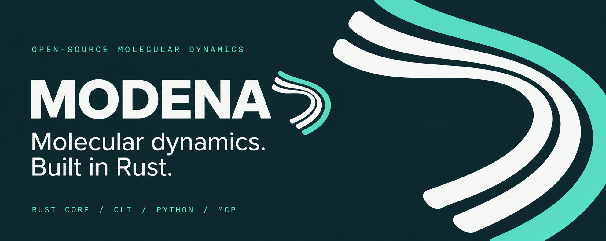

# MODENA

**Molecular Dynamics Engine for Numerical Atomistics.** An open-source Rust
engine for configuring, running, and inspecting classical atomistic simulations.

[](https://github.com/ricardoleal20/modena/actions/workflows/ci.yml)
[](Cargo.toml)
[](docs/VALIDATED_SCOPE.md)
[](LICENSE)

[Quickstart](#build-and-run) · [Capabilities](#what-you-can-explore) ·
[Python & MCP](#choose-your-interface) · [Documentation](#documentation) ·
[Contributing](#contributing)

Start with a TOML file. Validate the configuration, run the simulation, and
inspect XYZ trajectories and CSV thermodynamic logs. Use the Rust library to
extend the engine, Python to configure runs, or MCP to expose tools to a local
client.

> **Early development · v0.1.1.** APIs and input formats may change. Numerical
> checks cover selected models and workflows; they do not establish converged
> liquid properties or general agreement with a reference engine.
> Read the [validation scope and known limitations](docs/VALIDATED_SCOPE.md)
> before interpreting results.

## Why explore MODENA?

- **A small starting point.** The default CPU/Rayon build needs Rust 1.90+;
  no MPI installation or GPU runtime is required.
- **Inspect the whole workflow.** Text-based inputs, trajectory and thermo
  outputs, and restart checkpoints make runs accessible to your own tools.
- **Build on the engine.** Rust traits and documented input wiring provide
  extension points for new models and methods.
- **Follow the evidence.** Focused numerical checks, explicit limitations, and
  reproduction instructions accompany the implemented methods.

## Build and run

Install **Rust 1.90 or newer** and Git, then run from the repository root:

```bash
git clone https://github.com/ricardoleal20/modena.git
cd modena
cargo build --locked --release --bin modena

# Validate the input configuration.
cargo run --locked --release --bin modena -- check -i examples/argon_nve.toml

# Run your first simulation.
cargo run --locked --release --bin modena -- run -i examples/argon_nve.toml
```

The [argon example](examples/argon_nve.toml) runs **256 Lennard-Jones particles
for 2,000 NVE steps** in reduced units. Output paths resolve relative to the
input file:

| Output | What to inspect |
| --- | --- |
| `examples/argon_nve_traj.xyz` | Particle positions across trajectory frames |
| `examples/argon_nve_energy.csv` | Thermodynamic values across the run |
| CLI summary | Final energies, temperature, pressure, and NVE energy drift |

Energy drift is one numerical diagnostic; it does not establish physical
accuracy or converged sampling.

To put the CLI on your Cargo binary path from this checkout:

```bash
cargo install --locked --path crates/modena-cli
modena --help
modena check -i examples/argon_nve.toml
modena run -i examples/argon_nve.toml
```

Keep running example commands from the repository root so the input paths resolve.

## What you can explore

| Area | Implemented methods and workflows |
| --- | --- |
| Pair interactions | Lennard-Jones, Buckingham, Morse, soft-sphere, and tabulated models |
| Molecular interactions | Bond, angle, and dihedral terms; topology weights and exceptions; typed XYZ input |
| Time integration & ensembles | Velocity-Verlet NVE; Langevin BAOAB, stochastic velocity rescaling, and Nosé–Hoover chains for NVT |
| Electrostatics | Direct Ewald and orthorhombic SPME |
| Constraints & pressure | SHAKE/RATTLE, rigid-water projection, and unconstrained isotropic Monte Carlo NPT |
| Run workflows | TOML configuration, reduced/real unit I/O, XYZ trajectories, CSV logs, and restart checkpoints |

Constrained pressure is diagnostic; constrained NPT and full anisotropic
coupling are rejected. Water and chemical examples demonstrate workflows,
with material-property validation still incomplete. Optional MPI and GPU
backends are experimental library code with separate examples; enabling their
Cargo features does not select them in the ordinary TOML runner.
See [method coverage and limitations](docs/VALIDATED_SCOPE.md) for the details.

### Pick an example

| Explore | Start here |
| --- | --- |
| Your first NVE run | [Lennard-Jones argon](examples/argon_nve.toml) |
| Temperature control | [Langevin NVT](examples/argon_nvt.toml) |
| Molecular input & restart | [Chemical workflow guide](examples/chemical/README.md) |
| Charged particles | [Ionic SPME input](examples/chemical/ionic_spme.toml) |
| Isotropic pressure coupling | [Monte Carlo NPT input](examples/chemical/mc_npt.toml) |
| Fixed-volume water | [Water NVT input](examples/chemical/water_nvt.toml) |

These short examples are starting points for exploring the code, not validated
material parameter sets or equilibrium production studies.

## Choose your interface

| Interface | Use it to… | Guide |
| --- | --- | --- |
| **CLI** | Validate TOML inputs and run simulations from a terminal or script | [modena-cli](crates/modena-cli/README.md) |
| **Rust** | Embed and extend the engine | [modena-core](crates/modena-core/README.md) · [Extension guide](docs/EXTENDING.md) |
| **Python** | Build typed configurations and collect thermodynamic rows | [Python setup & examples](python/README.md) |
| **MCP** | Expose local simulation tools to an MCP client | [modena-mcp](crates/modena-mcp/README.md) |

The Python package requires Python 3.11+ and drives a separate MODENA CLI
executable through a subprocess. Its base package has no runtime dependencies.
The MCP server runs locally with your filesystem permissions; read the
[security policy](SECURITY.md) before running untrusted inputs.

## Documentation

| Looking for… | Read |
| --- | --- |
| Methods, evidence, and current limitations | [Validation scope](docs/VALIDATED_SCOPE.md) |
| Adding a potential or wiring a new input | [Extending the engine](docs/EXTENDING.md) |
| Units and normalization | [Unit conventions](docs/scientific-hardening/UNITS.md) |
| Numerical checks and reproduction | [Scientific results](docs/scientific-hardening/RESULTS.md) · [Verification guide](docs/scientific-hardening/VERIFY.md) |
| Release history | [Changelog](CHANGELOG.md) · [v0.1.1 release notes](docs/releases/v0.1.1.md) |
| Project internals and direction | [Architecture](ARCHITECTURE.md) · [Roadmap](ROADMAP.md) |
| Icons, banner, and visual identity | [Brand assets](assets/brand/README.md) · [Design system](DESIGN.md) |

Architecture and roadmap documents include design intent and historical
status. Use the validation scope, current source, and tests for release scope.

## Contributing

Help make molecular simulation easier to inspect and extend. Documentation
improvements, small reproducible bug reports, independent numerical checks,
and focused code changes are welcome.

1. Read the [contribution guide](CONTRIBUTING.md) and
   [code of conduct](CODE_OF_CONDUCT.md).
2. Find or open an [issue](https://github.com/ricardoleal20/modena/issues).
   Discuss substantial changes before implementation.
3. Make a focused change and run the relevant checks:

```bash
cargo test --locked --workspace
cargo fmt --all -- --check
cargo clippy --locked --workspace --all-targets -- -D warnings
```

For numerical changes, include units, tolerances, and an independent basis for
the expected result. The contribution guide covers the scientific harness,
Python checks, and optional backend checks.

Need help? See [support](SUPPORT.md). For repository practices, see
[commit rules](COMMIT_RULES.md), [governance](GOVERNANCE.md), and the
[maintainer guide](docs/MAINTAINING.md).

## License and citation

MODENA is available under the [MIT license](LICENSE).
If you use it in research, cite [CITATION.cff](CITATION.cff) and include the
version or commit used in your work.
